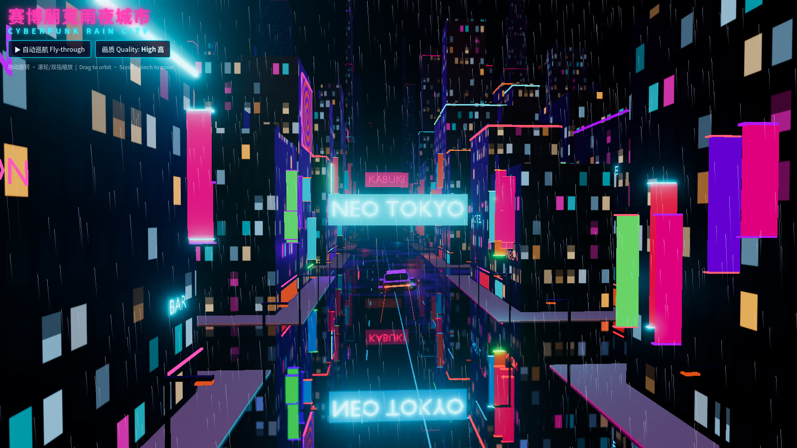
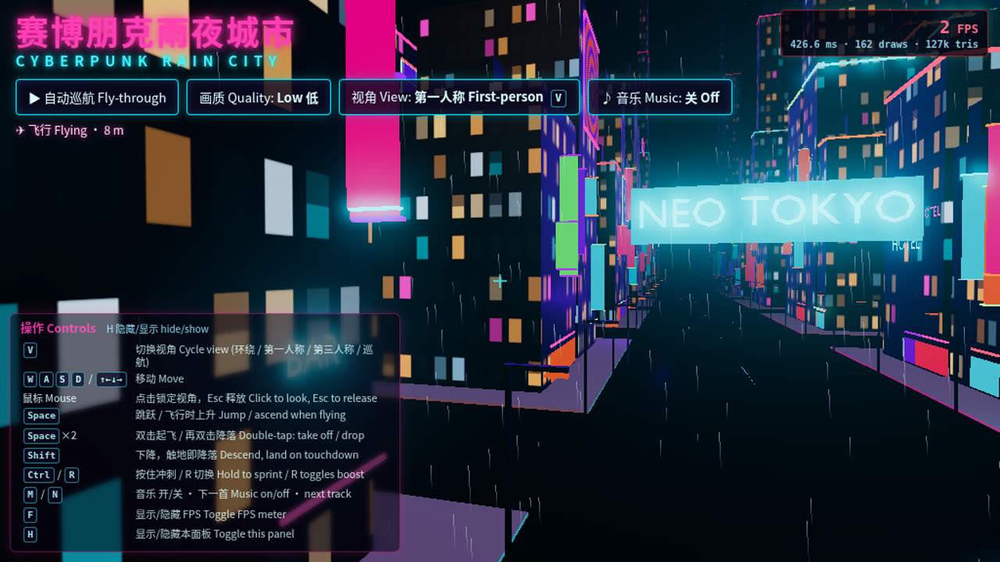
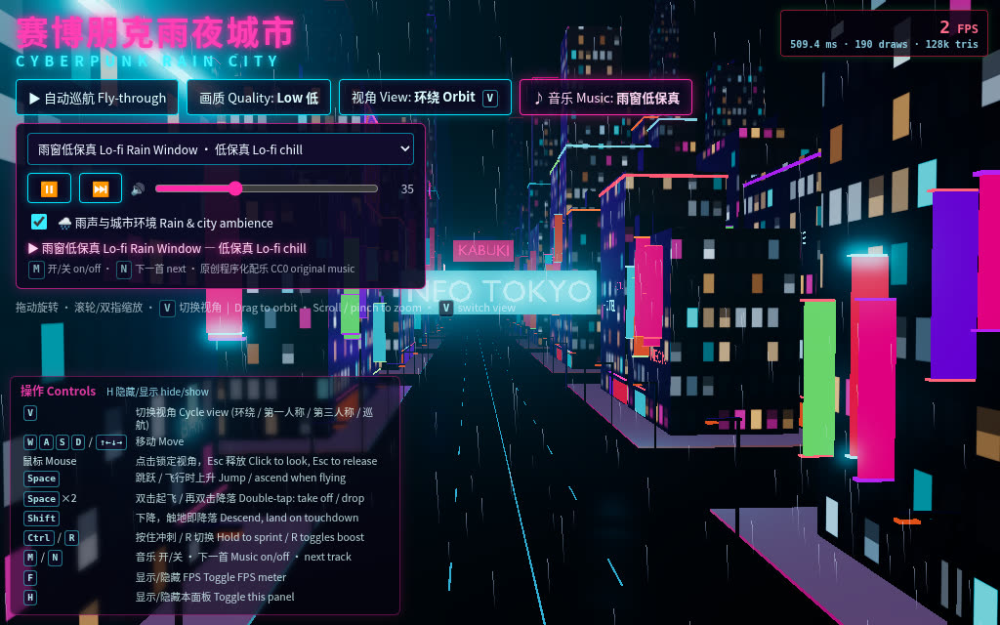
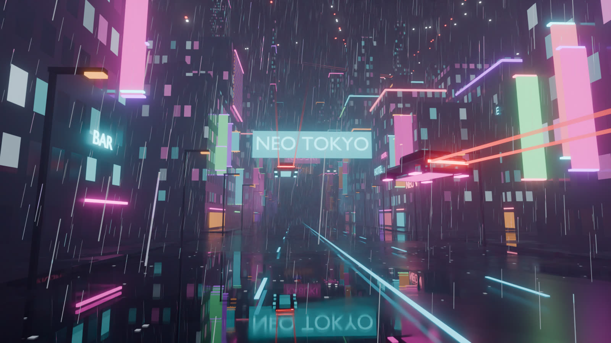
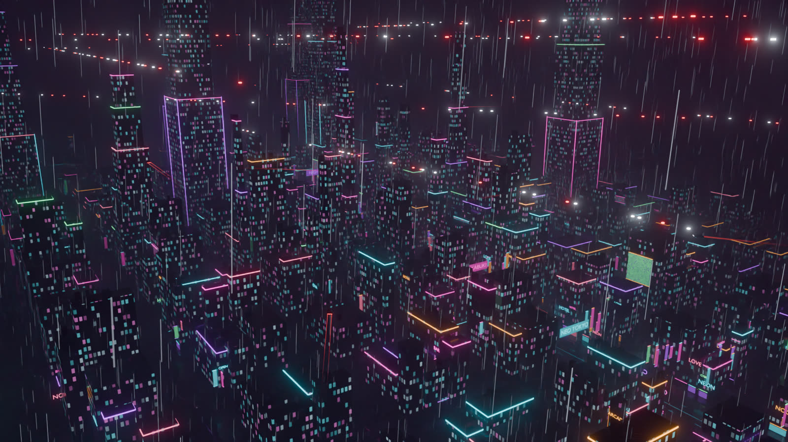

# 赛博朋克雨夜城市 · Cyberpunk Rain City

在浏览器里漫游一座下着雨的赛博朋克城市：霓虹、全息广告、飞行汽车、第一/第三人称行走与飞行，以及原创的程序化合成配乐。
A rainy cyberpunk city you can explore in the browser: neon signs, holographic billboards, flying cars, first/third-person walking & flight, and an original procedurally-synthesised soundtrack.



| 第一人称飞行 First-person flight | 音乐面板 Music panel | Blender 渲染 Blender render |
|---|---|---|
|  |  |  |

---

## 功能 Features

- **实时 3D 城市 Real-time city** — Three.js (r186) + 辉光后期 bloom、雨丝着色器 rain-streak shader、湿地面反射 wet-street reflections、雾、动态霓虹闪烁 neon flicker、最多 15 辆沿样条飞行的悬浮车 up to 15 hover cars on splines。
- **四种视角 Four views** — 环绕 Orbit / 第一人称 First-person / 第三人称 Third-person / 巡航 Fly-through（电影镜头 cinematic camera）。
- **游戏式操控 Game controls** — WASD 行走、跳跃、双击空格起飞、Shift 下降/着陆、冲刺、与建筑碰撞 building collisions (AABB)。
- **实时 FPS 显示 Live FPS meter** — 帧率、帧时间、draw calls、三角形数 FPS, frame time, draw calls, triangles。
- **可选配乐 Optional music** — 4 首原创无缝循环曲目 + 雨声环境层，音乐随节拍驱动辉光 beat-reactive bloom（默认关闭 off by default）。
- **移动端 Mobile** — 虚拟摇杆与触控按钮、自动低画质 auto low-quality preset, touch joystick & buttons。

## 操作 Controls

| 按键 Key | 作用 Action |
|---|---|
| `V` | 切换视角 Cycle view: 环绕 orbit → 第一人称 first-person → 第三人称 third-person → 巡航 fly-through |
| 鼠标 Mouse | 点击锁定视角，`Esc` 释放 Click to look around (pointer lock), `Esc` to release |
| `W` `A` `S` `D` / 方向键 arrows | 移动 Move |
| `Space` | 跳跃；飞行时上升 Jump; ascend while flying |
| `Space` ×2 | 双击起飞 / 再次双击降落 Double-tap: take off / drop |
| `Shift` | 下降，触地即着陆 Descend; lands on touchdown |
| `Ctrl` (按住 hold) / `R` (切换 toggle) | 冲刺 Sprint / boost |
| `F` | 显示/隐藏 FPS Toggle FPS meter |
| `H` | 显示/隐藏操作提示 Toggle the controls panel |
| `M` | 音乐 开/关 Music on/off |
| `N` | 下一首 Next track |
| 环绕模式 Orbit | 拖动旋转、滚轮/双指缩放 Drag to orbit, scroll / pinch to zoom |

顶部按钮 Top buttons: 自动巡航 Fly-through · 画质 Quality · 视角 View · ♪ 音乐 Music.

### URL 参数 URL parameters

| 参数 Param | 说明 Meaning |
|---|---|
| `?q=low` / `?q=high` | 强制低/高画质（默认按设备自动选择）Force quality (auto-detected by default) |
| `?view=orbit\|fp\|tp\|cine` | 初始视角 Start in a given view |
| `?fly` | 直接进入巡航镜头 Start in the fly-through |
| `?t=<seconds>` | 动画起始时间 Start the animation clock at t seconds |

例 Example: `http://localhost:5173/?view=fp&q=high`

## 运行 Run

需要 Node.js ≥ 20. Requires Node.js ≥ 20.

```bash
npm i
npm run dev        # 开发服务器 dev server → http://127.0.0.1:5173
npm run build      # 生产构建 production build → dist/
npm run preview    # 预览构建 preview the build → http://127.0.0.1:4173
```

`dist/` 是纯静态文件，可部署到任何静态托管（Cloudflare Pages、GitHub Pages、Netlify…）。
`dist/` is fully static and can be hosted anywhere.

### 测试 Tests (optional)

无头浏览器测试使用本机 Chrome（或设置 `CHROME_PATH`）。Headless tests use the local Chrome (or set `CHROME_PATH`):

```bash
npm run build && npm run preview &
npm run test:game    # 视角、移动、跳跃、飞行、着陆 views, movement, jump, flight, landing
npm run test:music   # 音乐面板、M/N、持久化 music panel, M/N keys, persistence
```

### 部署 Deploy (Cloudflare Pages)

`.github/workflows/deploy.yml` 会在推送到 `main` 时构建并通过 `cloudflare/wrangler-action` 部署到 Pages 项目 `cyberpunk-rain-city`。
需要在仓库 Secrets 中设置 `CLOUDFLARE_API_TOKEN` 与 `CLOUDFLARE_ACCOUNT_ID`。
On every push to `main` the workflow builds and deploys to the Pages project `cyberpunk-rain-city`; set the repo secrets `CLOUDFLARE_API_TOKEN` and `CLOUDFLARE_ACCOUNT_ID`. Manual deploy: `npx wrangler pages deploy dist --project-name=cyberpunk-rain-city` (or `npm run deploy:pages`).

## 资源是如何制作的 How the assets were made

- **城市模型 City** — 完全由 Blender 4.5 Python 脚本程序化生成 Generated procedurally by Blender Python scripts in [`blender/`](blender/):
  - `build_city.py` — 建筑、窗户、霓虹灯管、全息广告、雨、雾、Cycles 渲染 buildings, windows, neon tubes, billboards, rain, fog, Cycles renders: `blender -b -P blender/build_city.py -- --render both --out .`
  - `animate_city.py` — 飞行汽车动画与追踪镜头 flying-car animation & chase camera.
  - `export_web.py` — 合并网格、导出网页用 GLB merges meshes and exports a web GLB (`city_raw.glb`), then `npm run optimize:glb` → `public/city.glb` (meshopt, ~1.2 MB).
  - `export_colliders.py` — 导出建筑碰撞盒 exports building AABBs → `public/colliders.json`.
  - 雨、雾、灯光、车辆动画在网页端用 Three.js 重建 Rain, fog, lights and car motion are recreated in Three.js (`src/main.js`)。
- **配乐 Music** — [`music/synth.py`](music/synth.py) + [`music/tracks.py`](music/tracks.py)：用 numpy/scipy 从零合成（振荡器、滤波器、鼓、混响、延迟），无采样；以 ffmpeg 标准化到 −16 LUFS 并编码为 MP3，循环点无缝。
  Synthesised from scratch with numpy/scipy (oscillators, filters, drum synthesis, reverb, delay) — no samples; loudness-normalised to −16 LUFS with ffmpeg, encoded to MP3, seamless loop points. Regenerate with `pip install numpy scipy` and `PYTHONHASHSEED=0 python3 music/tracks.py` (needs `ffmpeg`).

| 曲目 Track | 风格 Style |
|---|---|
| 霓虹高速 Neon Highway | 合成波 Synthwave, 108 BPM |
| 雨夜银翼 Rain Runner | 银翼杀手式氛围 Blade-Runner-style ambient, 64 BPM |
| 暗网脉冲 Darknet Pulse | 暗黑合成 / 工业 Darksynth / industrial, 120 BPM |
| 雨窗低保真 Lo-fi Rain Window | 低保真 Lo-fi chill, 78 BPM |
| 雨声与城市环境 Rain & city ambience | 环境音 Ambience |



## 许可 License

- 代码 Code: [MIT](LICENSE)
- 配乐与环境音 Music & ambience (`public/audio/`): [CC0 1.0](https://creativecommons.org/publicdomain/zero/1.0/) — 见 see [CREDITS.md](CREDITS.md)
- 第三方依赖 Third-party: [three.js](https://threejs.org/) (MIT), [Vite](https://vite.dev/) (MIT)
